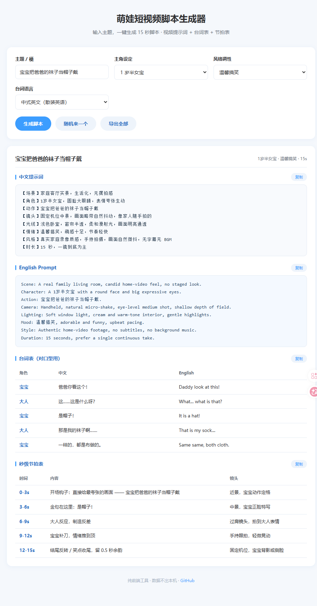

# 萌娃短视频脚本生成器

> 输入一个主题，一键生成 15 秒萌娃短视频的完整脚本：**AI 视频提示词 + 台词表 + 秒级节拍表**。

给做亲子 / 萌娃类短视频的创作者用的小工具。纯前端，零依赖，**双击 `index.html` 就能用**。



---

## 它能生成什么

| 产出 | 说明 |
|---|---|
| **中文提示词** | 结构化八要素：场景 / 角色 / 动作 / 镜头 / 光线 / 情绪 / 风格 / 时长，可直接粘贴进视频生成工具 |
| **English Prompt** | 中英对照的英文提示词，方便喂给英文生态的模型 |
| **台词表** | 角色 · 中文 · English 三列，专为「对口型」设计 |
| **秒级节拍表** | 0-3s / 3-6s / 6-9s / 9-12s / 12-15s 五段，标好每段内容和镜头建议 |

## 为什么是 15 秒

15 秒是短视频平台完播率最高的时长区间之一，也是多数 AI 视频生成工具在「一镜到底」模式下能稳定输出的长度。本工具的节拍表按 15 秒编排，金句固定落在 **3-6 秒**（观众注意力峰值段），结尾强制反转。

## 快速开始

### 方式一：直接打开（推荐）

1. 下载或克隆本仓库
2. **双击 `index.html`**
3. 填主题 → 点「生成脚本」

不需要装任何东西，不需要联网，不需要服务器。

### 方式二：克隆

```bash
git clone https://github.com/taolaikun/kids-shortvideo-script-gen.git
cd kids-shortvideo-script-gen
# 然后双击 index.html，或：
open index.html        # macOS
start index.html       # Windows
```

## 使用说明

| 选项 | 可选项 | 说明 |
|---|---|---|
| **主题 / 梗** | 自由输入 | 视频的核心笑点，越具体越好 |
| **主角设定** | 1 岁女宝 / 2 岁男宝 / 3 岁男宝 / 1 岁半女宝 | 影响提示词里的角色描述 |
| **风格调性** | 温馨搞笑 / 毒舌反转 / 奶凶霸气 / 萌系治愈 | 决定台词模板和情绪走向 |
| **台词语言** | 中式英文（散装英语）/ 纯中文 / 中英混搭 | 散装英语是本工具的特色 |

三个按钮：

- **生成脚本** —— 按当前设置出脚本
- **随机来一个** —— 从内置 15 个主题里随机抽一个，直接生成
- **导出全部** —— 把结果存成 `.txt` 文件

每个模块右上角都有 **复制** 按钮，单块内容一键拿走。

## 关于「散装英语」

中式英语梗是这类内容的核心笑点来源 —— 语法不对但意思到位，反差感极强。例如：

- `You can you do, no can no BB.`
- `You swan he frog.`
- `Same same, both cloth.`

工具内置了若干这类句式模板，配合「毒舌反转」风格使用效果最好。

## 技术说明

- **纯前端**：HTML + CSS + 原生 JS，单个文件，无框架、无构建、无依赖
- **零联网**：所有逻辑在本地跑，数据不出本机（没有埋点、没有请求）
- **模板引擎**：基于主题文本做哈希，同主题输出稳定可复现
- **兼容**：Chrome / Edge / Safari / Firefox 现代版本；手机浏览器也能用

## 自定义

想加自己的主题？打开 `index.html`，找到 `THEME_POOL` 数组：

```js
var THEME_POOL = [
  '宝宝把爸爸的袜子当帽子戴',
  '宝宝偷吃辣椒被辣哭还要嘴硬',
  // 在这里加你的主题
];
```

想改台词模板？找到 `makeLines()` 函数里的 `sets`，按 `{ who, cn, en }` 格式写就行。

## 路线图

- [ ] 更多风格模板
- [ ] 自定义时长（10s / 30s / 60s）
- [ ] 导出为 Markdown / CSV
- [ ] 角色形象描述片段库

## License

[MIT](LICENSE) —— 随便用，商用也行，署名不强制。

## 相关

如果你也在做 AI 短视频，欢迎提 Issue 交流。
